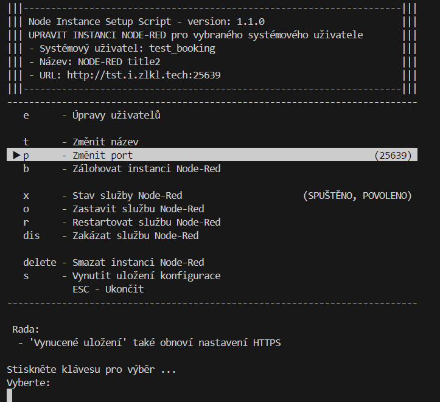

# JBLibs - python

Soubor pomocných knihoven pro python, changelog viz git změny

v1.2.35

## c_menu

Knihovna pro tvoření interaktivních a dynamických menu

**Aktuální info v komentářích knihovny:**

[dokumentace](c_menu.md)

**Příklad menu:**

## systemdService

Správa UNIX systemd service a timer, aktuální vlastnosti v komentářích knihovny

[dokumentace](systemdService.md)

## helper

Různé funkce, více viz komentáře knihovny

Správa textů jazyků [dokumentace](helper.md) aktuální verze jsou v knihovně

## term

Knihovna pro ANSI ovládání terminálu a vstup z něj

Více viz komentáře v knihovně

## input

Základní vstupy z klávesnice, jako heslo, obecný input, anyKey, confirm, select a sdílená interaktivní `terminal()` konzole s readline editací, dynamickým `header/footer`, statickým `title`, deklarativním prefix command dispatch včetně dynamické help metadata, kontextem callbacků, historií oddělenou podle konzole a volitelnou persistencí.

`c_menu` callable akce, `select()` a `confirm()` po přijetí platné volby okamžitě vypíšou stav zpracování, aby uživatel neopakoval vstup během pomalejší akce. Výchozí text používá `{value}`; podporovaný je i alias `%v%`. Prázdný `processingText=""` feedback vypne.

Víc v komentářích knihovny

## fs_utils

`lsblkDiskInfo.isSystemDisk` rozpoznává systémovou partition i její rodičovský disk podle child stromu a mountpointů `/`, `/boot` nebo `/boot/efi`.

`lsblk_list_disks()` podporuje také starší util-linux bez sloupců `MOUNTPOINTS` nebo `PTUUID`; singular `MOUNTPOINT` normalizuje a chybějící whole-disk PTUUID read-only doplní přes `blkid`.

## fs_helper

Knihovna pro práci se souborovým systémem, interaktivní výběr souborů/adresářů v terminálu.
Více viz [dokumentace](Readme_fs_helper.md)
